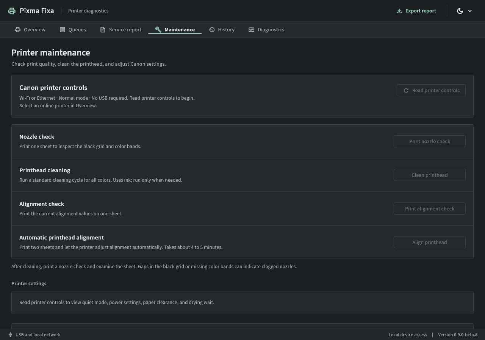

# Pixma Fixa

A free, open-source Windows utility for maintaining Canon PIXMA printers. Built
and hardware-tested for the PIXMA G7020, with a simple interface for diagnostics,
ink counts, printhead care and guarded waste-counter repair.

**Hardware-tested only on a Canon PIXMA G7020, firmware 1.050.** Other printers
have not been validated and may not work. You are welcome to try read-only
discovery, status and connection checks and [send a model report](SUPPORT.md).
A G7000 family name is not proof that another regional model is compatible.
Do not bypass the model or firmware checks to try maintenance or resets.

**[Download for Windows x64](https://github.com/themichaeldaniels/pixma-fixa/releases/download/v0.9.0-beta.8/PixmaFixa-Windows-0.9.0-beta.8.zip)**

[Release notes and all downloads](https://github.com/themichaeldaniels/pixma-fixa/releases/tag/v0.9.0-beta.8)
 · [Checksums](https://github.com/themichaeldaniels/pixma-fixa/releases/download/v0.9.0-beta.8/SHA256SUMS.txt)
 · [Source archive](https://github.com/themichaeldaniels/pixma-fixa/releases/download/v0.9.0-beta.8/PixmaFixa-source-0.9.0-beta.8.zip)

Current release: **0.9.0-beta.8**, Windows x64. Extract the entire ZIP, then run
`pixma_fixa.exe`. No installer, Python setup, account, or purchased reset key is
needed to use the app. While this repository is private, GitHub access is required
to download its files. macOS and Android builds are not available yet.

## Why it exists, and why it is free

### Canon 5B00: ink absorber full

| Item | What it means |
| --- | --- |
| Support code | **5B00** |
| Canon's published error message | **“Printer error has occurred.”** |
| Problem addressed by this tool | The waste-ink absorber counter has reached its service limit, commonly called **ink absorber full**. |
| Canon's repair instruction | **“Contact your nearest Canon service center to request a repair.”** |

The message and repair instruction above are from Canon's [G7000 series 5B00
manual page](https://ij.manual.canon/ij/webmanual/ErrorCode/G7000%20series/EN/ERR/5B00.html).
The counter explanation describes the supported G7020 service profile; Canon's
public error page gives the generic printer-error message.

Cleaning and ink flushing send waste ink into pads inside the printer. The
printer tracks estimated absorber use in a software counter. At its service
limit, printing is blocked. Replacing the pads does not by itself clear that
stored counter. Resetting the counter does not empty the pads, and a reading
of zero does not prove the pads are dry or safe to reuse.

I ran into this on my own printer. The only options I kept being offered were
paying for a reset tool or taking it to a service center. I was aggravated that
even after servicing the pads, I still needed to pay just to clear a counter.
I wanted a free way to do that repair, so I built Pixma Fixa. It offers the
supported counter reset without charging for a key or a subscription, along with
the maintenance and diagnostic controls listed below.

Pixma Fixa makes the supported maintenance operations available without paid reset
keys, subscriptions or an account. It is released under the [zlib license](LICENSE),
so anyone can inspect, use and improve it. It works locally and has no analytics,
advertising or built-in upload service. Required third-party license notices are
included. This is an independent project, unaffiliated with Canon.

### Replace full or blocked pads before resetting

**If the waste-ink pads are saturated, blocked or full of ink, replace them
before resetting the waste counter or running Ink Flush again on the printer.**
More flushing or cleaning sends more ink into the absorber. With full or blocked
pads, that ink can spill out of the printer. A software reset cannot fix that
physical problem. Pixma Fixa shows this warning before a waste-counter reset and
requires acknowledgment of the spill risk as well as absorber-service confirmation.

**Waste-counter reset and Ink Flush are different operations.** This app does
not run Ink Flush. It also keeps remaining-ink count resets separate from the
waste-ink absorber counter.

## Start here

1. Download the Windows ZIP above and extract it into a regular folder.
2. Keep `pixma_fixa.exe`, both helper executables, the DLLs and `data` together.
3. Open the app with the printer powered on normally. Use **Find printers**, or
   **Add by address** if automatic network discovery is unavailable.
4. Read the model, firmware, current errors and ink estimates in **Overview**.
5. Open **Maintenance** for the controls supported by the selected printer. Each
   operation explains its preparation and asks for confirmation before it runs.

**The 5B00 waste-ink counter reset requires a USB data cable and manual service
mode. It cannot be done over Wi-Fi with this app.** Connecting the printer to
Wi-Fi, or resetting its remaining-ink counts, does not clear the waste counter.
The app includes the verified G7020 service-mode procedure. Service the absorber
before resetting its counter; the reset does not remove ink from the pads.

### Enter service mode on the PIXMA G7020

This is the sequence used on the tested **G7020, firmware 1.050**. It is not a
general procedure for every PIXMA model. Power is the **ON** button on the panel;
Stop is the button marked with a triangle inside a circle.

1. Connect the printer to the PC with a **USB data cable**. Turn the printer off
   with its Power button and wait for shutdown to finish and the power light to
   go out. Leave the power cord connected.
2. Press and **hold Power**.
3. While continuing to hold Power, **press and release Stop six times**.
4. Release Power. Wait for the mechanism to settle and the **green power LED to
   stay on steadily**. The LCD should be blank or black in this mode.
5. In Pixma Fixa, open **Service report**, find the service printer and run
   diagnostics. Let the app confirm the USB service connection and read live
   evidence before attempting any supported repair. A steady LED alone does not
   prove that the correct service interface is available.
6. When the operation has finished, turn the printer off with Power, wait for it
   to shut down, then power it on normally to leave service mode. The app cannot
   do this remotely.

If the normal error screen returns, the alarm keeps flashing, or the app cannot
find a USB service printer, stop and check the connection and sequence. Do not
send a reset or try arbitrary extra button presses. USB report reads and the
waste-counter reset do not require paper; printed maintenance checks are separate.

These steps reflect the G7020 hardware test, rather than a Canon-published
service-mode procedure. Canon's [operation panel guide](https://ij.manual.canon/ij/webmanual/Manual/All/G7000%20series/EN/UG/ug-160.html)
identifies the ON and Stop buttons. Other models can use different sequences;
no verified service-mode instructions for other models are included yet. Do not
assume the six-press sequence applies to another printer.

### Which connection does each feature use?

| Feature | Connection | Printer mode |
| --- | --- | --- |
| Model, firmware, ink estimates, errors and network usage | Wi-Fi or Ethernet on the same local network | Normal |
| Remaining-ink counts after refilling the tanks | Wi-Fi or Ethernet; no USB needed | Normal |
| Standard cleaning, nozzle check, alignment check, automatic alignment and supported settings | Wi-Fi or Ethernet; no USB needed | Normal |
| Jobs received by the printer | Wi-Fi or Ethernet | Normal |
| Jobs in a Windows print queue | Windows spooler on this PC; its installed queue may use USB or the network | Independent of service mode |
| USB service report and waste-ink counter reading | USB data cable; Wi-Fi unsupported | Manual service mode |
| Waste-ink absorber counter reset for 5B00 | USB data cable; Wi-Fi unsupported | Manual service mode |

These are the current app capabilities for the verified G7020 profile. USB-only
normal-mode cleaning or remaining-ink reset is not implemented. The app cannot
enter or exit service mode remotely. The native nonzero waste reset remains
Experimental, as described below.

If a requested action fails, the app shows the returned error and the connection
steps for that action. A service-printer search explains when USB is missing or
the printer is still in normal mode. Network actions explain how to reconnect or
add the address. Automatic refresh failures stay inline. Dismissing an error
does not retry the command; check the history before repeating an uncertain reset
or maintenance operation.

See the [complete usage guide](START-HERE.txt), [beta notes](BETA-NOTES.md) and
[hardware validation](VALIDATION.md). The Windows package is currently unsigned.

## What it does

- Discover network printers and read identity, firmware, estimated ink, current errors, and reported capabilities.
- Read G7000 page counts and printhead replacement counters.
- Reset remaining-ink counts after confirming the selected tanks were refilled.
- Run standard printhead cleaning, nozzle checks, alignment-value checks, and automatic printhead alignment.
- Read and change quiet mode, automatic power on/off, paper-abrasion prevention, and ink drying wait.
- Inspect the printer queue and separately selected Windows queues; cancel only confirmed jobs.
- Read the USB service report and perform a guarded waste-counter reset after absorber servicing.
- Keep local history, repair follow-ups, diagnostic exports, report comparisons, and offline protocol inspection.
- Follow Windows appearance automatically, with persistent Light and Dark overrides.

Document scanning, document previews, PDF generation, and scan archives are removed in 0.7.0. Existing files from older versions are preserved. General document printing is outside this utility's scope.

## Compatibility and verification



Windows x64 is the supported platform. Canon maintenance and reset commands are restricted to the G7020/G7000 profile and firmware 1.050. A family name alone does not establish compatibility with every regional model. Other IPP printers can expose read-only status and queue capabilities. G6020 is a research candidate, with no service writes enabled.

| Feature | Evidence |
| --- | --- |
| Identity, firmware, ink estimates, usage, settings reads | Verified on the connected G7020 |
| Remaining-ink resets | Each color acknowledged and independently read back at 100% |
| Standard cleaning and five settings | Hardware tested, settings restored |
| USB service report, history/export and reset guards | Hardware tested |
| Waste-counter clear | Original protocol reset succeeded; native nonzero clear remains untested |
| Nozzle/alignment checks | Matching jobs completed, both sheets printed and photographed; no obvious nozzle defects in the supplied photo |
| Automatic printhead alignment | One matching calibration job completed in about 4 minutes 19 seconds; saved A-T values read back, with seven adjustments changed |
| Queue cancellation | Completed, held one-page Canon Windows spool job canceled; changed identity rejected; physical in-flight IPP job cancellation remains untested |
| Portable startup and upgrade | Extracted ZIP runs with a restricted PATH and unrelated working directory; prior settings, history, guards and saved files preserved |

Ink percentages are stored estimates, not physical tank measurements. Remaining-ink reset and waste-absorber reset are separate operations. A counter reset does not remove waste ink. Full EEPROM backup, firmware flashing, ink flush, deep cleaning, and unvalidated model writes are not implemented.

Automatic printhead alignment uses two plain Letter or A4 sheets in the front
cassette and takes about 4 to 5 minutes. It prints and measures alignment patterns
and saves the adjustment in the printer. The separate alignment check prints
existing values on one sheet. Alignment requires live capability/identity checks,
an idle error-free printer, reported ink in all colors and preparation confirmation.
The app tracks the matching job for up to ten minutes, records adjustment values
before and after completion when available, and never repeats an uncertain command.

## Release status

Extract the complete Windows ZIP and run `pixma_fixa.exe`. Keep both helper executables, DLLs, and the data directory together. See [START-HERE.txt](START-HERE.txt).

The current package is a Windows beta. Version 0.9.0-beta.8 passed automated startup and interactive checks in fresh Windows Sandbox without development tools. The final review corrected privacy, parser, resource-bound, clock-rollback and helper/window lifecycle issues. Both-theme native reporting, save cancellation and valid JSON export before browser handoff passed. See REVIEW.md for the scope and remaining limits. No issue was submitted. All 168 regression tests pass; static analysis is clean. Distribution files are unsigned. Native nonzero waste-counter clear and printer-side in-flight job cancellation are marked Experimental and require acknowledgment. The waste reset also requires acknowledgment of the spill risk. See [BETA-NOTES.md](BETA-NOTES.md) and [VALIDATION.md](VALIDATION.md) for the evidence and limits.

## Build and test

The final review and corrected issues are documented in [REVIEW.md](REVIEW.md).
Use `-OutputDirectory C:/releases/PixmaFixa` with the build script to choose a
package location outside the checkout.

Use Flutter 3.47.7 / Dart 3.13.5 and Visual Studio with Desktop development with C++. From the project directory:

```powershell
./tool/build-windows.ps1 -FlutterRoot C:/src/flutter
```

The script resolves locked dependencies, runs static analysis and tests, compiles native USB/queue helpers, builds the release application, and creates a portable ZIP. Debug symbols are kept outside that ZIP. See [TESTING.md](TESTING.md) for the regression inventory and manual checks.

## Data and transaction handling

Application data lives in `%LOCALAPPDATA%/PrinterCare`, retaining the existing data-folder name to preserve earlier history, preferences and transaction guards. History and settings remain local. Full report exports contain private printer information; the separate diagnostic summary omits known serials, network addresses and raw USB paths. Review exports before sharing.

Mutations require live identity/readiness checks and explicit preparation. Uncertain commands are never automatically repeated. Waste resets use an exclusive durable attempt marker; refill/maintenance attempts have persistent guards. An OS file lock serializes recorded transactions across instances sharing the same state directory. Losing a reply does not establish success. Repair verification requires a normal restart, same-device status, and display confirmation.

Only service selector `10077c`, report query `15`, and waste clear `0d0000` are exposed by the USB worker. The worker runs separately to bound stalled driver calls. Normal-mode Canon commands use bounded CHMP requests. Network queues use IPP status/listing/identity/cancellation only; no print documents or empty Create-Job probes are submitted by the utility. Jobs still held on other computers or phones are outside this PC's view.

## Getting help

Use **Diagnostics > Report a problem > Save report and open issue form**. Choose
where to save the diagnostic `.json`; the app saves it and opens the GitHub form.
The saved path stays visible. Review the file before attaching it. The report
uses the readings and errors already captured, without sending printer commands
or clearing the failure. The app does not attach files or submit an issue for you.

See [SUPPORT.md](SUPPORT.md) for the exact steps to export diagnostics or request
another model. Reports can help us investigate without owning the printer;
they cannot by themselves establish that a new write command is safe.

Read the [usage guide](START-HERE.txt) first. If something goes wrong, [open an
issue](https://github.com/themichaeldaniels/pixma-fixa/issues) with the app version,
Windows version, printer model and firmware, the action taken, and the visible
error. Use the redacted diagnostic summary where possible. Review any export or
screenshot before sharing; do not post serial numbers or private network details.

## License

Zlib. Required upstream and dependency attribution is retained in [THIRD_PARTY_NOTICES.txt](THIRD_PARTY_NOTICES.txt). Font assets are bundled under their included license. No proprietary vendor executable, firmware image, installer, or reset key is distributed.
